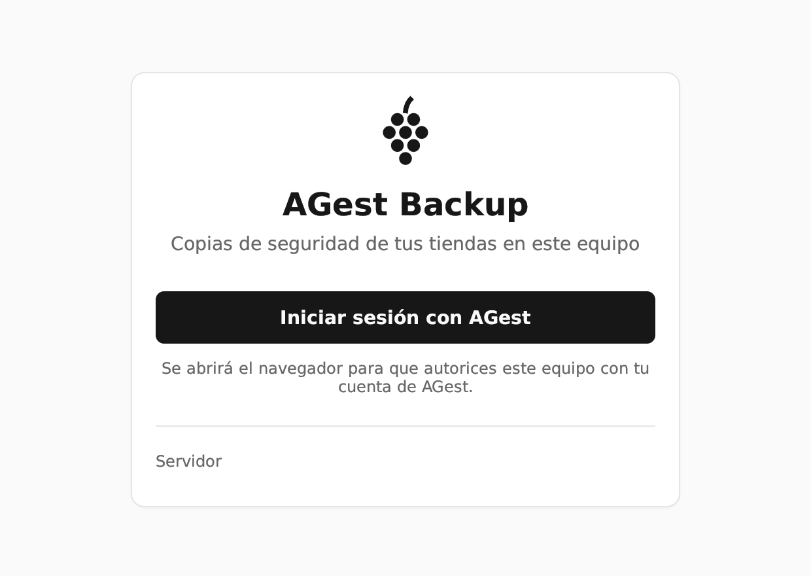
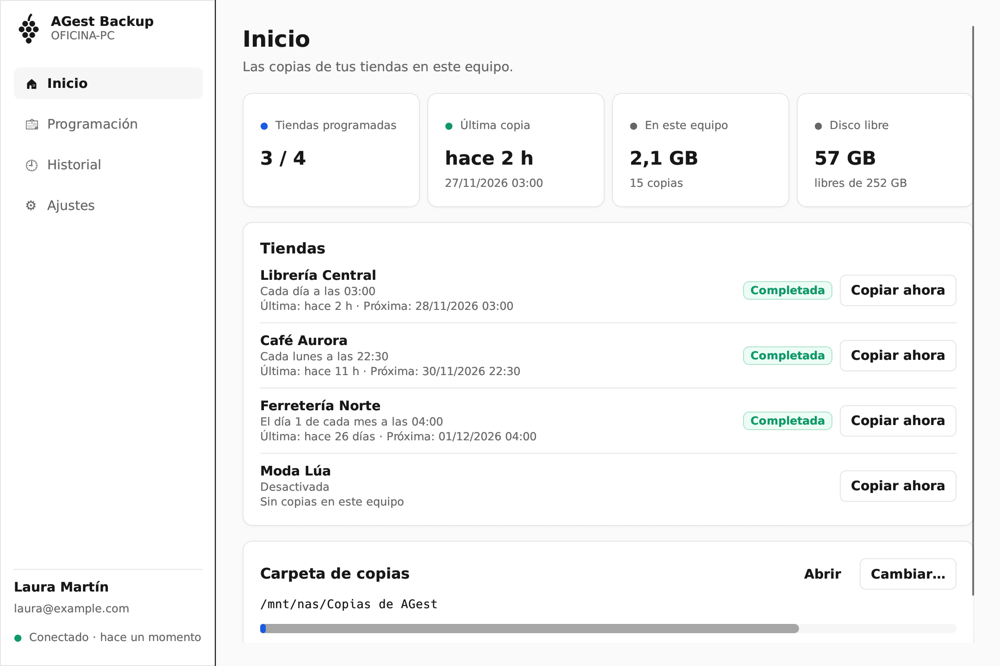
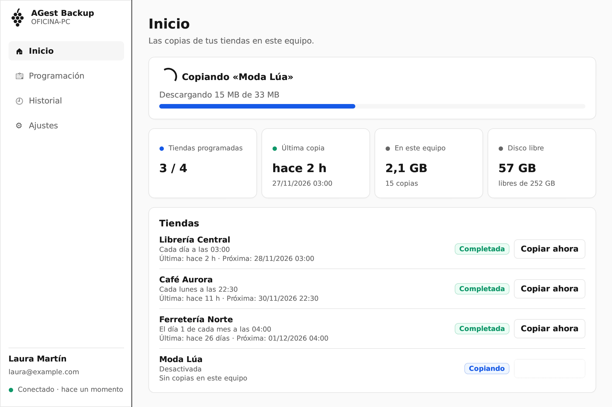
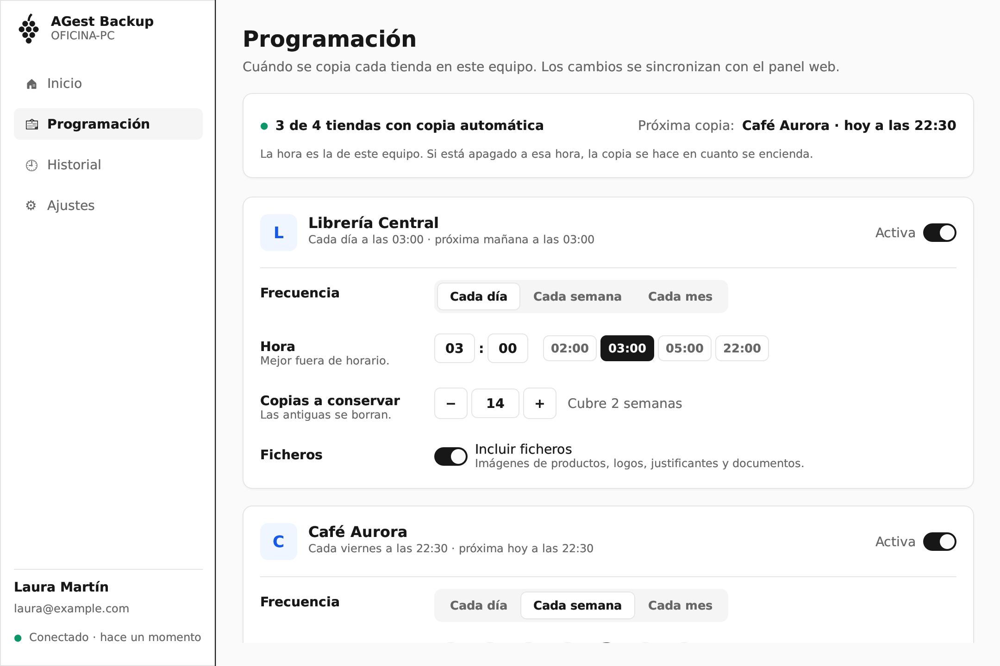
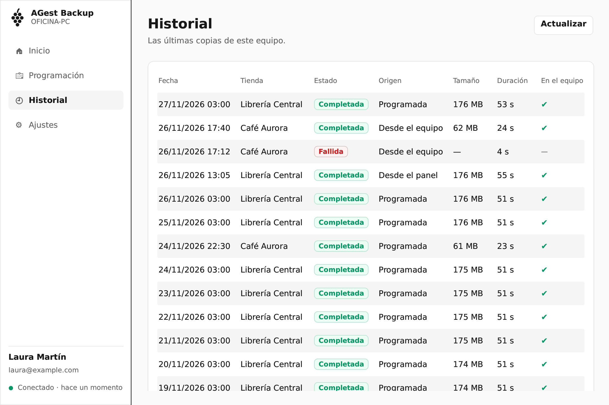
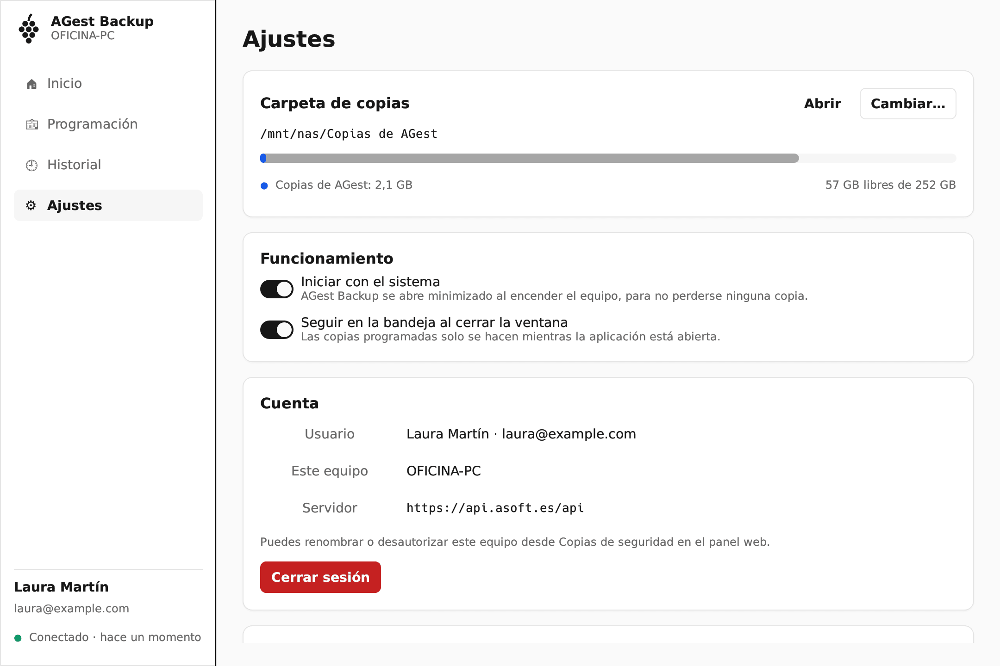
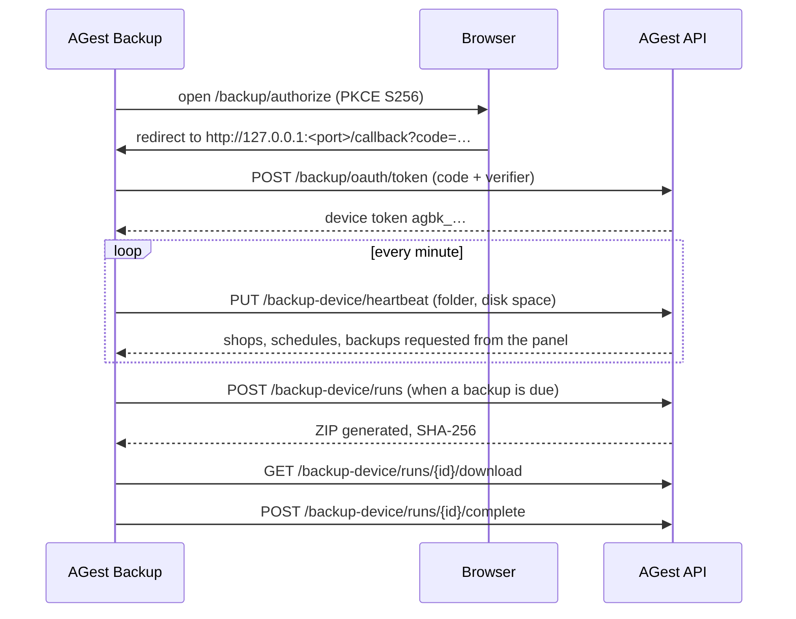

<div align="center">

<picture>
  <source media="(prefers-color-scheme: dark)" srcset="docs/screenshots/login-dark.png">
  
</picture>

# AGest Backup

**Keep your own copy of every [AGest](https://agest.asoft.es) shop, on your own disk.**

A small desktop app that runs in the system tray and downloads scheduled, SHA-256-verified backups of your AGest shops to a local drive, an external disk or a network share.

[](https://github.com/asoft-sl/agest-backup/releases/latest)
[](#requirements)
[-orange?logo=rust)](https://www.rust-lang.org)
[](https://github.com/emilk/egui)

[**Download for Windows**](https://github.com/asoft-sl/agest-backup/releases/latest/download/agest-backup.exe) ·
[All releases](https://github.com/asoft-sl/agest-backup/releases) ·
[Leer en español](README.es.md)

</div>

---

## Table of contents

- [Features](#features)
- [Screenshots](#screenshots)
- [Requirements](#requirements)
- [Installation](#installation)
- [Usage](#usage)
- [Command-line interface](#command-line-interface)
- [Backup format](#backup-format)
- [How it works](#how-it-works)
- [Building from source](#building-from-source)
- [Development](#development)
- [Releasing a new version](#releasing-a-new-version)
- [Security and local data](#security-and-local-data)
- [Contributing](#contributing)
- [License](#license)

## Features

- **Browser sign-in, no passwords in the app.** OAuth 2.0 with PKCE: you authorize the computer from your AGest account in the browser.
- **Per-shop schedules.** Daily, weekly or monthly, at the time you choose, keeping the last *N* copies of each shop.
- **Verified backups.** Every backup is a `.zip` with all the shop's data as JSON plus its files (product images, logos, receipts), checked against the server's SHA-256 before it is kept.
- **Managed from the web panel too.** In AGest (*Configuración → Copias de seguridad*) you can see every backup computer, its free disk space and history, change schedules and request a backup on demand. Changes sync both ways.
- **Runs in the background.** Lives in the system tray, can start with the computer, and catches up on missed backups when the computer is switched back on.
- **Self-updating.** Downloads new releases from GitHub, verifies their SHA-256 and installs them when no backup is running.
- **Headless mode.** The same executable works as a CLI for servers and the Windows Task Scheduler.

## Screenshots

> The user interface is currently in Spanish. It follows your system's light or dark theme.

<table>
  <tr>
    <td width="50%">
      <picture>
        <source media="(prefers-color-scheme: dark)" srcset="docs/screenshots/home-dark.png">
        
      </picture>
      <p align="center"><b>Home</b>: status of every shop, last backup and free disk space.</p>
    </td>
    <td width="50%">
      <picture>
        <source media="(prefers-color-scheme: dark)" srcset="docs/screenshots/progress-dark.png">
        
      </picture>
      <p align="center"><b>Backup in progress</b>: download with live progress.</p>
    </td>
  </tr>
  <tr>
    <td width="50%">
      <picture>
        <source media="(prefers-color-scheme: dark)" srcset="docs/screenshots/schedules-dark.png">
        
      </picture>
      <p align="center"><b>Schedules</b>: frequency, time, retention and whether to include files.</p>
    </td>
    <td width="50%">
      <picture>
        <source media="(prefers-color-scheme: dark)" srcset="docs/screenshots/history-dark.png">
        
      </picture>
      <p align="center"><b>History</b>: every run, its origin, size and whether it is on this computer.</p>
    </td>
  </tr>
  <tr>
    <td width="50%">
      <picture>
        <source media="(prefers-color-scheme: dark)" srcset="docs/screenshots/settings-dark.png">
        
      </picture>
      <p align="center"><b>Settings</b>: backup folder, startup behaviour and account.</p>
    </td>
    <td width="50%">
      <picture>
        <source media="(prefers-color-scheme: dark)" srcset="docs/screenshots/login-dark.png">
        
      </picture>
      <p align="center"><b>Sign in</b>: authorize the computer from the browser.</p>
    </td>
  </tr>
</table>

<sub>Screenshots use demo data.</sub>

## Requirements

- **Windows 10 or 11.** This is the supported platform. macOS and Linux are not officially supported yet (see [Building from source](#building-from-source)).
- An **AGest account with an active subscription**. Backups are managed by the account owner.
- To build from source: [Rust](https://rustup.rs) **1.85 or later** (edition 2024) and, on Windows, the Visual Studio build tools (MSVC).

## Installation

1. [Download `agest-backup.exe`](https://github.com/asoft-sl/agest-backup/releases/latest/download/agest-backup.exe) (or [build it yourself](#building-from-source)).
2. Run it. No installer is needed.

To uninstall, turn off *Iniciar con el sistema* (*Start with the system*) and sign out in *Ajustes* (Settings), quit the app from the tray and delete the executable. Backups already on disk are never deleted.

## Usage

1. Click **Iniciar sesión con AGest** (*Sign in with AGest*). Your browser opens: sign in if asked and click **Autorizar** (*Authorize*).
2. Choose the **folder** where backups will be stored. A subfolder is created for each shop.
3. In **Programación** (*Schedules*), enable each shop and choose when to back it up. You can also do this from the AGest web panel; changes are synced.

**Copiar ahora** (*Back up now*) starts a backup immediately. Closing the window keeps the app running in the tray (this can be turned off in *Ajustes*).

> [!NOTE]
> Scheduled backups only run while the app is open (in the window or in the tray). If the computer was off at the scheduled time, the backup runs as soon as it is switched on. Enable *Iniciar con el sistema* (*Start with the system*) so you never miss one.

### Updates

The app checks for a new version one minute after starting and then every 6 hours. When one is available it is downloaded next to the executable and its SHA-256 is verified. It is installed automatically once the app is in the tray and no backup is running, and the app restarts in the tray.

With the window open, a **Reiniciar y actualizar** (*Restart and update*) button appears in the sidebar and in *Ajustes → Actualizaciones*, where you can also check manually or turn automatic updates off. If you quit with an update already downloaded, it is installed for the next start.

### Signing out

Click **Cerrar sesión** (*Sign out*) in *Ajustes*, or revoke the computer from the web panel. Backups already on disk are kept.

## Command-line interface

The same executable runs without a window, which is useful on servers or with the Windows Task Scheduler. It shares the session, folder and backup logic with the desktop app.

```text
agest-backup login             authorize this computer (opens the browser)
agest-backup folder <path>     choose the backup folder
agest-backup status            shops, schedules and disk space
agest-backup backup [--shop ID | --due]
                               back up one shop, the ones that are due (--due) or all of them
agest-backup update            install the latest version, if there is a newer one
agest-backup logout            sign out and revoke this computer
agest-backup help              show help
```

For example, an hourly scheduled task running `agest-backup backup --due` performs any pending backups without the app being open.

## Backup format

```text
<backup folder>/
├── 12-my-shop/
│   ├── agest-12-my-shop-20261126-030000.zip
│   └── ...
└── .agest-backup/index.json     (local index, hidden)
```

Inside each `.zip`:

| Path | Contents |
|---|---|
| `manifest.json` | Format version, shop, date, rows per table and the list of files with their SHA-256 |
| `datos/<table>.json` | One JSON array per table with the shop's rows (products, tickets, invoices, customers…) |
| `ficheros/<disk>/<path>` | Product images, logos, expense receipts and library documents |
| `LEEME.txt` | Short explanation (in Spanish) |

Credentials, tokens and secrets (passwords, certificates, API keys) are **never** included. This version does not restore backups; the JSON files can be opened with any tool.

## How it works



1. **Sign-in**: OAuth 2.0 *authorization code* flow with PKCE (S256) and a loopback redirect ([RFC 8252](https://www.rfc-editor.org/rfc/rfc8252)). The app opens `https://<panel>/backup/authorize`, the owner authorizes it, and the browser returns to `http://127.0.0.1:<port>/callback`. The app exchanges the code for an `agbk_…` device token that is only valid for the backup API.
2. **Heartbeat** every minute (`PUT /api/backup-device/heartbeat`): sends the folder, disk space and the size of the backups, and receives the shops, their schedules and any backups requested from the panel.
3. **Scheduling** is decided by the app using local time. A backup is due if the last successful one is older than the last scheduled slot; after a failure it retries after 30 minutes.
4. **Backup**: the server builds the ZIP; the app downloads it to `….zip.part` while computing its SHA-256, compares it with the server's, renames it and confirms the run. It then applies retention: deletes the oldest backups of that shop and notifies the panel.
5. **Updates**: reads `https://api.github.com/repos/asoft-sl/agest-backup/releases/latest`. If the tag (`vX.Y.Z`) is newer than the version in `Cargo.toml`, it downloads that release's `agest-backup.exe` to `agest-backup.exe.new` and requires its SHA-256 to match the one GitHub computes (the asset `digest`) or, failing that, the attached `agest-backup.exe.sha256`. To install, it renames the running executable to `.old`, moves the new one into place and launches it with `--updated` (plus `--minimized` if it was in the tray). The `.old` file is removed on startup. Debug builds do not self-update unless `AGEST_BACKUP_UPDATE_URL` is set.

### Project structure

| File | Responsibility |
|---|---|
| `src/main.rs` | Entry point: GUI or CLI |
| `src/api.rs` | API client (`/backup/oauth/*`, `/backup-device/*`) |
| `src/oauth.rs` | PKCE, loopback server and code exchange |
| `src/config.rs` | Local configuration and token in the OS credential store |
| `src/worker.rs` | Control threads (heartbeat, scheduling) and backup threads; download with SHA-256 |
| `src/schedule.rs` | When the next backup is due |
| `src/store.rs` | Local index, retention and disk space |
| `src/app.rs`, `src/theme.rs` | User interface and styling |
| `src/tray.rs` | System tray icon |
| `src/update.rs` | Self-update from GitHub releases |
| `src/cli.rs` | Command-line interface |

## Building from source

```bash
git clone https://github.com/asoft-sl/agest-backup.git
cd agest-backup
cargo build --release
```

The executable is written to `target\release\agest-backup.exe`. Release builds do not open a console window; CLI commands attach to the console they are launched from.

<details>
<summary>Building on Linux (not officially supported)</summary>

The project compiles on Linux with the GTK development libraries and an explicit windowing backend for `eframe`:

```bash
sudo apt install libgtk-3-dev libxdo-dev libayatana-appindicator3-dev libssl-dev pkg-config
cargo build --features eframe/x11
```

The command-line interface works, but the desktop app does not start on Linux yet: the tray icon requires GTK to be initialized first.

</details>

## Development

```bash
cargo run                                  # desktop app
cargo test                                 # scheduling, PKCE, retention, download and SHA-256
cargo clippy --all-targets -- -D warnings  # lint
cargo fmt                                  # format
```

By default the app connects to production (`https://api.asoft.es/api`). To use a local backend, click *Servidor → Desarrollo* on the sign-in screen (`https://agest-backend.test/api`), or set `AGEST_API_URL` on first launch.

| Environment variable | Effect |
|---|---|
| `AGEST_API_URL` | Initial server (only used when there is no saved configuration yet) |
| `AGEST_BACKUP_UPDATE_URL` | Alternative URL to check for updates (testing); also enables the updater in debug builds |
| `AGEST_BACKUP_NO_BROWSER=1` | Do not open the browser on sign-in; print the link instead. The waiting screen also has *Copiar enlace* (*Copy link*) |

## Releasing a new version

1. Bump `version` in `Cargo.toml` and build in release mode.
2. Create a GitHub release tagged `vX.Y.Z` (not marked as a pre-release) and attach `agest-backup.exe` (with exactly that name) and `agest-backup.exe.sha256`.
3. Computers running the app install it automatically within the next 6 hours.

## Security and local data

- **Configuration** (server, folder, preferences): `%APPDATA%\ASoft\AGest Backup\data\config.json`.
- **Device token**: stored in the operating system's credential store (Windows Credential Manager, service `agest-backup`), never in a file.
- The server only stores a hash of the token. Revoking the computer from the panel invalidates it immediately.
- Backups are stored **unencrypted**. Protect the folder (permissions, BitLocker, an external disk kept somewhere safe) as you would any copy of your data.

If you find a security vulnerability, please **do not open a public issue**. Report it privately through [GitHub Security Advisories](https://github.com/asoft-sl/agest-backup/security/advisories/new).

## Contributing

Bug reports and pull requests are welcome.

1. Open an [issue](https://github.com/asoft-sl/agest-backup/issues) describing the bug or the change you propose.
2. Fork the repository and create a branch from `main`.
3. Make sure `cargo fmt`, `cargo clippy --all-targets -- -D warnings` and `cargo test` pass.
4. Open a pull request explaining what changed and why.

Code comments and user-facing text are written in Spanish, matching the AGest web panel.

## License

Copyright © ASoft SL. All rights reserved. This software is currently proprietary (see `license` in [`Cargo.toml`](Cargo.toml)).
